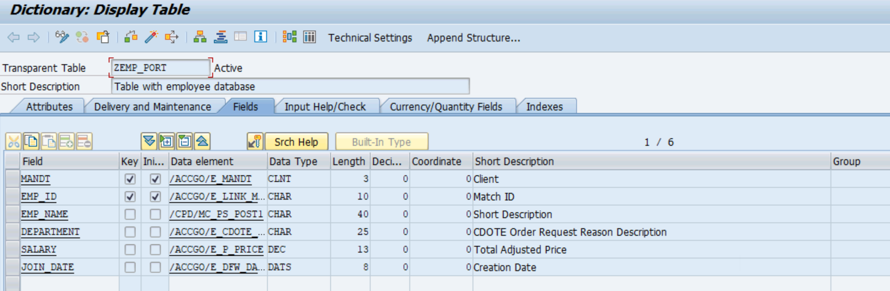

# SAP ABAP Employee Management & Reporting System

## 1. Project Overview

An SAP ABAP-based Employee Management and Reporting System developed using SAP GUI. This project demonstrates database operations, employee data retrieval, selection screens, internal table processing, and salary calculations.

## 2. Technologies Used

- SAP ABAP
- SAP GUI
- SE11 – Data Dictionary
- SE38 – ABAP Editor
- Open SQL
- Internal Tables and Work Areas
- Selection Screens

## 3. Database Design

**Custom Database Table:** `ZEMP_PORT`

| Field | Description |
|---|---|
| MANDT | SAP Client |
| EMP_ID | Employee ID |
| EMP_NAME | Employee Name |
| DEPARTMENT | Department |
| SALARY | Employee Salary |
| JOIN_DATE | Employee Joining Date |

## 4. Implemented Features

- Custom employee database table creation.
- Employee master data insertion.
- Employee filtering using PARAMETERS and SELECT-OPTIONS.
- Employee data retrieval using Open SQL.
- Employee record counting.
- Total salary calculation.
- Average salary calculation.
- Handling cases where no matching records are found.

## 5. Project Screenshots

Screenshots demonstrating the database structure, employee records, selection screen, and report output are included in this repository.

## 6. Learning Outcomes

- SAP ABAP report programming.
- SAP Data Dictionary fundamentals.
- Open SQL database operations.
- Selection-screen development.
- Internal table and work area processing.
- Salary calculations using ABAP.

## 7. Project Status

**Version 1 – Core employee reporting functionality implemented.**

### Future Enhancements
- Modular programming using FORM and PERFORM.
- ALV reporting.
- Debugging and testing improvements.

## Project Screenshots

### Database Structure

### Employee Records

### Selection Screen

### Report Output

